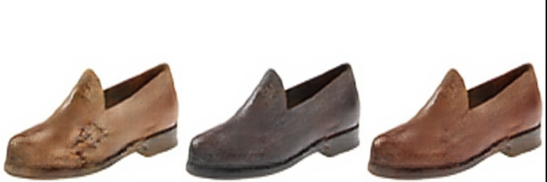
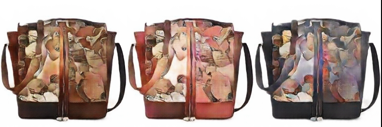

# BicycleGAN

BicycleGAN is a method for multimodal image-to-image translation.

## Installation

```console
git clone https://github.com/bareform/dependencies.git
conda update -n base -c defaults conda
conda env create -f dependencies/environment.yml
conda activate bareform

git clone https://github.com/bareform/bicyclegan.git
cd bicyclegan
```

<details>
  <summary> Dependencies (click to expand) </summary>
  
  ## Dependencies
  - Python 3.10
  - datasets
  - numpy
  - torch
  - torchvision
    
</details>

## Quick Start

To train a low-precision `edges2shoes` pix2pix:

```
python3 -m utils.trainer --config="./configs/edges2shoes.toml"
```

After training for 25 epochs, you can find results similiar to the image at `./assets/edges2shoes/edges2shoes.png`:



To train a low-precision `edges2handbags` pix2pix:

```
python3 -m utils.trainer --config="./configs/edges2handbags.toml"
```

After training for 25 epochs, you can find results similiar to the image at `./assets/edges2handbags/edges2handbags.png`:




You can download the pre-trained models [here](https://huggingface.co/luethan2025/bicyclegan) and use the provided Jupyter Notebook `inference.ipynb` to generate some samples.

## Method

[Toward Multimodal Image-to-Image Translation](https://arxiv.org/abs/1711.11586)

Jun-Yan Zhu<sup>1</sup>, Richard Zhang<sup>1</sup>, Deepak Pathak<sup>1</sup>, Trevor Darrell<sup>1</sup>, Alexei A. Efros<sup>1</sup>, Oliver Wang<sup>2</sup>, Eli Shechtman<sup>2</sup>

<sup>1</sup>UC Berkeley, <sup>2</sup>Adobe Research

> Many image-to-image translation problems are ambiguous, as a single input image may correspond to multiple possible outputs. In this work, we aim to model a distribution of possible outputs in a conditional generative modeling setting. The ambiguity of the mapping is distilled in a low-dimensional latent vector, which can be randomly sampled at test time. A generator learns to map the given input, combined with this latent code, to the output. We explicitly encourage the connection between output and the latent code to be invertible. This helps prevent a many-to-one mapping from the latent code to the output during training, also known as the problem of mode collapse, and produces more diverse results. We explore several variants of this approach by employing different training objectives, network architectures, and methods of injecting the latent code. Our proposed method encourages bijective consistency between the latent encoding and output modes. We present a systematic comparison of our method and other variants on both perceptual realism and diversity.

## Citation

The original paper can be found at:
```
@misc{zhu2017bicyclegan,
    title={Toward Multimodal Image-to-Image Translation},
    author={Jun-Yan Zhu and Richard Zhang and Deepak Pathak and Trevor Darrell and Alexei A. Efros and Oliver Wang and Eli Shechtman},
    year={2017},
    eprint={1711.11586},
    archivePrefix={arXiv},
    primaryClass={cs.CV}
}
```
